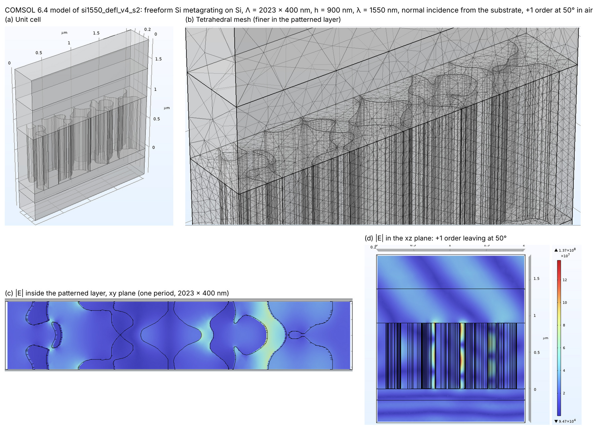

# COMSOL validation (optional, local)

A third, independent check of a finished design with COMSOL Multiphysics 6.4 (Wave Optics, finite elements),
next to TORCWA (RCWA, the optimizer) and Meep (FDTD). The three methods make different numerical errors, so
agreement between them is a strong result.

- **Opt-in.** Use it only when the user asks for it and has COMSOL with the Wave Optics module.
- **Local only.** Run it on a workstation or a Mac with a COMSOL licence. HPC clusters usually have no COMSOL
  server licence, and the bridge does not queue COMSOL jobs.
- **Same pattern as `ptpipe`.** It has three parts: a model per run, a run script, and a comparison with a verdict.

## Files

| File | What it does |
|---|---|
| `comsol_export.py` | Run directory → one Java model per mesh level, `runs/<dir>/comsol/MS_<case>_L<k>.java`, plus `<case>_plan.json` (geometry check, stack, orders, mesh plan). |
| `run_comsol.sh` | Compiles each `.java` into a `.class` (`comsol compile`) and, unless `--build-only`, solves it in batch (`comsol batch`). |
| `comsol_compare.py` | Compares COMSOL with `rcwa_ref.json` (or `--rcwa <file>`), and with Meep (`validation.json` or the highest `meep_res<R>.json`). Writes `runs/<dir>/comsol_validation.json`. |

Everything a run produces stays in `runs/<dir>/comsol/`, and `runs/` is not tracked by git.

## Quick start (test case `si1550_defl_v4_s2`)

The COMSOL check was tested on `si1550_defl_v4_s2`, the robust freeform metagrating of the paper. It is a demanding
case:

- Si on Si, Λ = 2023 × 400 nm, h = 900 nm, +1 order at 50°;
- x and y polarization;
- a pattern that varies in x and y, which the model represents with smoothed contours (pixel agreement 99.99 %).

On a Mac mini with 16 GB (COMSOL 6.4, GMRES), the two polarizations take under 4 minutes per level in total:

- L1: 1.79 M DOF, 47–61 s per polarization, 8.4 GB peak RAM;
- L2: 2.39 M DOF, 98–102 s per polarization, 9.6 GB peak RAM.

The results are in [Test results](#test-results-si1550_defl_v4_s2).

```bash
python tools/seed_examples.py
python validation/comsol/comsol_export.py --run runs/si1550_defl_v4_s2
bash validation/comsol/run_comsol.sh --build-only runs/si1550_defl_v4_s2
```

Open `runs/si1550_defl_v4_s2/comsol/MS_si1550_defl_v4_s2_L1.class` in COMSOL (*File > Open*) to inspect the model.
Opened this way, the class builds geometry, materials, physics, mesh sequence, study and solver sequence, but does not
mesh or solve.

Solve both mesh levels in batch and compare:

```bash
bash validation/comsol/run_comsol.sh runs/si1550_defl_v4_s2
python validation/comsol/comsol_compare.py --run runs/si1550_defl_v4_s2 --rcwa rcwa_ref_o70.json
```

`--rcwa rcwa_ref_o70.json` compares with RCWA at [70, 12] instead of [35, 7]. Reference values for order +1:

| Polarization | η RCWA [70, 12] | T RCWA [70, 12] | η Meep (60 px/µm) |
|---|---|---|---|
| x | 0.806 | 0.818 | 0.801 |
| y | 0.636 | 0.657 | 0.628 |

Meep is read from `meep_res60.json` when there is no `validation.json`.

Before the first run, set *Preferences > Security > File system access: All files*. The classes write their log
and results next to themselves.

The COMSOL executable defaults to `/Applications/COMSOL64/Multiphysics/bin/comsol`. Set `COMSOL=/path/to/comsol`
to use another one. Useful options:

- `--cores N` leaves cores free so you can keep using the computer;
- `--no-save` skips the solved `.mph` (130–170 MB per level for this case; `comsol batch -nosave`);
- `--mesh-only` builds the mesh and logs the element count.

## Reading the results in the GUI (Global Evaluation)

After a solve in the GUI, use *Results > Derived Values > Global Evaluation*. The model starts with `pol = 0`
(input polarization x). For y, set `pol = 1` in *Global Definitions > Parameters* and compute again.

Variable names follow the order (m, n): `p1` = +1, `m1` = −1, `0` = 0. For example, `etaT_p1_0` is the transmitted
order (+1, 0) and `etaR_m2_0` the reflected order (−2, 0). The variables exist only for the orders that propagate;
`<case>_plan.json` lists them (`orders_T`, `orders_R`).

The expected values below are for `si1550_defl_v4_s2`, from RCWA [70, 12]:

| Expression | Meaning | Expected x | Expected y |
|---|---|---|---|
| `etaT_p1_0` | transmitted order +1 (the target), from the field | 0.806 | 0.636 |
| `etaT_0_0`, `etaT_m1_0` | transmitted orders 0 and −1 | | |
| `ewfd.Ttotal` | total transmission from the ports | 0.818 | 0.657 |
| `ewfd.Rtotal` | total reflection from the ports | 0.184 | 0.343 |
| `T_flux` | transmission from the Poynting flux on the observation plane | ≈ `ewfd.Ttotal` | ≈ `ewfd.Ttotal` |
| `etaR_m4_0` … `etaR_p4_0` | reflected orders in the substrate, except (0,0) (optional) | | |

The same three gates as in `comsol_compare.py` must each be below 0.01:

- `ewfd.Ttotal+ewfd.Rtotal-1`
- `T_flux-ewfd.Ttotal`
- `etaT_m1_0+etaT_0_0+etaT_p1_0-ewfd.Ttotal`

The third one uses the sum of all transmitted orders. A solve in the GUI does not write `_results.json`:
`comsol_compare.py` reads only the batch results.

## Test results: si1550_defl_v4_s2

Run on 26 Nov 2026 with COMSOL 6.4.0.378 on a Mac mini with 16 GB. The settings were the defaults of `comsol_export.py`:

- mesh L1 / L2 in the patterned layer, λ/(8n) outside;
- GMRES;
- normal incidence from the Si substrate, 1550 nm.



*The COMSOL model of `si1550_defl_v4_s2`:*

- *(a) the 3D unit cell: Si substrate, freeform Si layer and air, with the observation planes and the ports;*
- *(b) the tetrahedral mesh, finer in the patterned layer;*
- *(c) |E| inside the patterned layer, over one period;*
- *(d) |E| in the xz plane, where the tilted wavefronts above the structure are the +1 order leaving at 50°.*

Efficiency of the transmitted order (+1, 0):

| Pol | COMSOL L1 | COMSOL L2 | RCWA [35,7] | RCWA [50,10] | RCWA [70,12] | Meep 40 / 50 / 60 px/µm | Verdict |
|---|---|---|---|---|---|---|---|
| x | 0.8081 | 0.8078 | 0.8048 | 0.8063 | 0.8055 | 0.804 / 0.801 / 0.801 | agree (Δη 0.2 pt, ΔT 0.4 pt) |
| y | 0.5980 | 0.5977 | 0.6643 | 0.6456 | 0.6358 | 0.603 / 0.638 / 0.628 | marginal (Δη 3.8 pt, ΔT 2.5 pt) |

COMSOL self-consistency, level L2:

| Pol | R + T | T_flux − T_port | Σ Fourier orders − T_port | L1 → L2 shift of η |
|---|---|---|---|---|
| x | 1.0000 | 0.003 | 0.006 | 0.04 pt |
| y | 1.0000 | 0.002 | 0.000 | 0.03 pt |

Reading:

- **x polarization.** The three solvers agree within 0.7 points.
- **y polarization.** COMSOL is converged with the mesh: the two levels differ by 0.03 points and all gates pass.
  RCWA is still moving with the truncation, from 0.664 to 0.646 to 0.636 as the order goes from [35,7] to [50,10]
  to [70,12]. It moves towards the COMSOL value. Meep varies by ±2 points between resolutions.
- **The y gap.** The 3.8-point difference from RCWA [70, 12] is therefore mainly RCWA truncation. The formal verdict
  stays `marginal` until RCWA at a higher order (more y harmonics) confirms it.

A first test with λ/(5n) outside the patterned layer gave T_flux and the Fourier sum 1–2 points above the port
transmission. The default is now λ/(8n), with λ/(12n) on the observation planes.

## Mesh levels L1 and L2

`comsol_export.py` writes two models of the same cell by default, which differ only in the element size in the
patterned layer. The substrate and the superstrate use λ/(8n) in both, and λ/(12n) on the observation planes.

| Level | Element size in the patterned layer | `si1550_defl_v4_s2` | Cost |
|---|---|---|---|
| L1 | 60 nm | 1.79 M DOF, about 1 min per polarization | lighter |
| L2 | 45 nm | 2.39 M DOF, about 1.7 min per polarization | more accurate, about twice as slow |

The two levels check that COMSOL is converged with the mesh, as two or three resolutions do for Meep.
`comsol_compare.py` takes L2 as the COMSOL value and reports how much η moves from L1 to L2. If COMSOL does not
agree with RCWA, the shift decides between `inconclusive` and a real gap (`marginal` or `disagree`): see Verdict.

- To solve one level only, give its class name:
  `bash validation/comsol/run_comsol.sh runs/<dir> MS_<case>_L1`.
- To write one level only, use `--levels 1`.
- To change the sizes, use `--hpat-nm 60 45`.
- To inspect a model in the GUI, open the L1 class: it is the lighter one.

## What the model contains

**Cell.** It is the 3D unit cell of the run, with Floquet periodic conditions on x and y:

- the substrate is below (z < 0) and the superstrate above;
- the patterned layer is `layer.thickness_nm` thick, with the binary design of the run (`rho_binary.npy` or
  `rho_supercell.npy`);
- indices (n, k) come from `config.json`. Tabulated and refractiveindex.info materials are evaluated at the
  wavelength.

**Geometry.** It depends on the design:

- **1D designs** (no variation along y, tiled in y for 3D solvers): exact rectangles on the pixel edges, as RCWA
  sees them;
- **freeform designs**: 0.5 iso-contours of the design smoothed by 1 px. This needs `pip install shapely
  scikit-image`. The export stops if the pixel agreement with the binary design is below 99.9 %
  (`--min-agreement`).

The cell is translated, which is a pure translation of a periodic pattern, so the efficiencies do not change:

- the x faces cut only background where an empty column exists;
- faces that do cut the pattern cross its edges transversally.

Vertices on opposite faces are matched pairwise, so the Copy Face mesh is periodic.

**Ports.** These are periodic ports:

- `port1` is on the incidence side (substrate for `from_substrate`), excited with 1 W, E along the pipeline input
  polarization (`pol = 0` → x, `pol = 1` → y);
- `port2` is on the transmission side;
- diffraction orders come from the port command. Where it is not available, the class creates explicit
  `DiffractionOrder` nodes (both polarizations) for every propagating order, plus `OrthogonalPolarization`.

**Paddings.** The distances between the structure, the observation planes and the ports come from the decay
length of the slowest evanescent order on each side. Gratings close to a Rayleigh anomaly get thicker paddings.

**Mesh.** Copy Edge / Copy Face on the periodic faces, then Free Tetrahedral, with these sizes:

- λ/(8n) in the substrate and the superstrate, and λ/(12n) on the observation planes (`--n-per-lambda`).
  λ/(5n) was too coarse for the field analysis: in a first test T_flux and the sum of the Fourier orders came
  out 1–2 points above the port transmission;
- `h_pat` in the patterned layer: level L1 60 nm, L2 45 nm (`--hpat-nm`).

The planner estimates DOF and RAM for `--ram-gb` (default 16) and drops the levels that do not fit:

- measured peak RAM with GMRES: 8.4 GB at 1.79 M DOF and 9.6 GB at 2.39 M DOF; 3.5 M DOF still fit in 16 GB, while
  3.3 M DOF did not fit with the direct solver. The DOF estimate is calibrated on `si1550_defl_v4_s2` and is
  conservative for finer levels;
- the linear solver is always the suggested iterative one, set to GMRES, because the direct solver needs too much
  RAM for 3D cells. The solver sequence is created in every mode, so a model opened in the GUI already uses it.
  The direct solver is only a fallback, if GMRES fails on a model below 0.5 M DOF. The log names the solver nodes
  and the one used.

**Results.** `MS_<case>_L<k>_results.json` holds, per polarization:

- `T`: transmitted efficiency of every propagating order, from a Fourier projection of the field on an observation
  plane, η(m,n) = A·|E_mn|²·Re(k_z)/(2·Z0·k0·P_in). It is independent of the port post-processing;
- `R_nonzero`: reflected orders other than (0,0), computed the same way on the incidence side;
- `T_flux` (Poynting flux through the observation plane), `T_port` and `R_port` (`ewfd.Ttotal`, `ewfd.Rtotal`);
- DOF and solve time.

The log `MS_<case>_L<k>_log.txt` holds:

- `WARN` lines for every setting that could not be applied;
- the property dump of the ports and of the periodic condition;
- the solver nodes chosen.

## Verdict

`comsol_compare.py` uses the thresholds of `configs/validation_policy.json`, the same as for Meep:

| Verdict | Condition |
|---|---|
| `agree` | \|Δη\| ≤ `eta_abs` (0.03) and \|ΔT\| ≤ `flux_abs` (0.02) |
| `inconclusive` | a COMSOL gate fails; or not agree and only one mesh level exists; or the two mesh levels differ by more than half the gap |
| `marginal` | not agree, gap ≤ 2 `eta_abs` |
| `disagree` | otherwise |

COMSOL gates (each must hold):

- |R_port + T_port − 1| < 0.01 (lossless stacks);
- |T_flux − T_port| < 0.01;
- |Σ Fourier orders − T_port| < 0.01.

Only the polarizations in `objective.input_pols` decide the run verdict; the others are reported alongside.

If the verdict is `disagree`, diagnose in this order:

1. Raise the RCWA order: `python validation/rcwa_reference.py --run runs/<dir> --order Nx Ny`. Freeform cells
   with high index contrast can need more y harmonics.
2. Refine the mesh: `--hpat-nm 45 35`.
3. Check the geometry: pixel agreement and notes in `<case>_plan.json`.

Edge shifts: `comsol_export.py --shift-nm 10` applies the same exact edge shift as `rcwa_reference.py --shifts 10`.
The case gets a suffix (`_sp10`, `_sm10`) and is compared with the matching RCWA entry.

## COMSOL notes (6.4.0.378)

- The physics tag and the variable prefix are both `ewfd` in these models (`ewfd.Ex`, `ewfd.Poavz`, `ewfd.Ttotal`).
  ptpipe reports `emw` for its templates. To change it, edit `PFX` in the class.
- Names verified against a solved-model export:
  - `PeriodicCondition` with `PeriodicType = Floquet` and `kFloquet` as `String[][]`;
  - `Port` with `PortType = Periodic`, `Pin`, and `Eampl` as `String[][]`;
  - subnodes `DiffractionOrder` (`mOrder`, `nOrder`, `components = outofplane`) and `OrthogonalPolarization`;
  - material group `create("RefractiveIndex", "RefractiveIndex", "Refractive index")` with `n` and `ki`;
  - Box / Union selections.
- The port's (m, n) axes are chosen by COMSOL and can differ between the two ports. The explicit fallback covers
  both assignments.
- `System.getenv` is not allowed in COMSOL classes. The class reads its mode from `MS_<case>_L<k>.mode`, which
  `run_comsol.sh` writes.
- Leave a few seconds between `compile` and `batch` on slow or external disks. The script does this.
- Java methods are limited to 64 KB of bytecode. Polygon coordinates go in one method per 1000 vertices.
- Oblique incidence: the port angle names (`alpha1_inc`, `alpha2_inc`) and the E amplitude are not verified in 3D.
  The class logs a WARN; check them in the GUI.
- On macOS zsh, do not add `# comments` to commands typed in the terminal.
